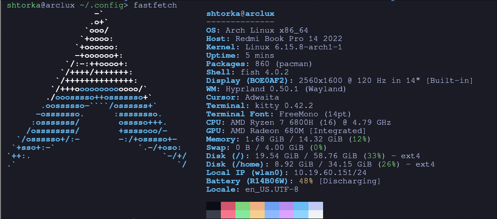

# Dotfiles for Hyprland

<p align="center">
  <a href="https://github.com/Shturmill/dotfiles/stargazers">
    
  </a>
  <a href="https://github.com/Shturmill/dotfiles/commits/main">
    
  </a>
</p>

**This repository contains the author's personal configuration files for Hyprland and related applications, along with an automated installation script.**



## Requirements

- Arch Linux or an Arch-based distro: packages are installed with `pacman` and `yay`.
  Without `pacman` the installer switches to `--no-pkg` and only copies configs,
  Firefox settings, fonts and the shell.
- A Hyprland release with the Lua config API: the session loads `hyprland.lua`.
- `sudo` for the package, Docker and shell steps.
- `~/.local/bin` on `PATH`: helper scripts from `bin/` are installed there.

## What gets installed

| Step | What it does | Skip with |
|------|--------------|-----------|
| Dependencies | `sudo pacman -Syu` (full system upgrade), then Hyprland, Kitty, Waybar, Wofi, Mako, Satty, Hyprlock/Hypridle, Thunar, Zed, Firefox, Chromium, Telegram, fish and utilities | `--skip-deps` |
| yay + AUR | Builds `yay`, installs `wlogout` from the AUR | `--skip-yay`, `--skip-aur` |
| Docker | docker, compose, buildx, `docker.service`; adding you to the `docker` group is asked separately (default no) | `--skip-docker` |
| Nerd Fonts | Selected fonts into `~/.local/share/fonts` | `--skip-nerdfonts` |
| Firefox | Writes `firefox.txt` into the profile's `user.js` | `--skip-firefox` |
| Shell | Changes the login shell to fish | `--skip-shell` |
| Configs | `config/*` into `~/.config`, `bin/*` into `~/.local/bin` | `--skip-configs` |
| Reboot | Offers a reboot at the end | `--skip-reboot` |

Each step asks before acting. `--only-<step>` runs a single step, `--no-pkg`
skips every step that needs a package manager, and `--defaults` answers every
question with its default (never reboots) for unattended runs. Full list:
`./install.sh --help`.

## Installation

```bash
git clone https://github.com/Shturmill/dotfiles
cd dotfiles
./install.sh --dry-run   # preview, changes nothing
./install.sh
```

### After installing

Edit `~/.config/hypr/hyprland.lua`:

- Monitor lines are hardcoded for the author's two displays: `HDMI-A-1` at
  `3440x1440@100` and `eDP-1` at `2560x1600@120`, scale 1.25. Replace them with
  your own outputs (`hyprctl monitors` lists the names).
- The lid-switch binds only switch `eDP-1` off, so a closed lid with HDMI
  attached stays in clamshell mode. Their comment refers to the NixOS setup
  (`HandleLidSwitch=lock`); the installer does not touch logind, so on Arch
  closing the lid suspends the laptop. Add a drop-in in
  `/etc/systemd/logind.conf.d/` with `HandleLidSwitch=lock` if you want the
  NixOS behaviour.

### Re-running the installer

- Configs are updated file by file. Files that were removed from this repository stay in `~/.config` until you delete them, as do files you added yourself (e.g. a local `monitors.conf`).
- Firefox settings go to the profile's `user.js`. Removing a line from `firefox.txt` does not revert that setting: Firefox already copied its value into `prefs.js`, so reset it in `about:config`.
- Pass one `--only-*` flag at a time; combining two runs nothing.

### Backups and restoring

Every file the installer replaces is backed up to `~/.dotfiles_backups`:

- `~/.dotfiles_backups/<run>/`: the files replaced by that run; the last 10 runs are kept.
- `~/.dotfiles_backups/original/`: the first version of every replaced file, i.e. your own configs from before the installer ran. Never pruned.
- `~/.dotfiles_backups/original/legacy/`: backup runs of installer 2.1 and older, moved here on the first run of a newer one. Never pruned.

To undo the installer, copy the files from `original/` back into `~/.config`.

## Hyprland configuration

The session loads `config/hypr/hyprland.lua`, written against Hyprland's Lua
API (`hl.monitor`, `hl.bind`, ...): monitors, autostart, environment, appearance,
input, keybindings and window rules.

| File | Purpose |
|------|---------|
| `hyprland.conf` | Earlier Hyprlang version of the same setup, kept for reference; the session does not load it. |
| `hypridle.conf` | Idle timeouts; `on-ac` picks the action for the current power source. |
| `hyprlock.conf` | Lock screen. |

Colours are written as `@base05@`-style placeholders, filled from
`lib/palette.env` when the installer copies the config.

Other configs in `config/`: Kitty, Waybar, Wofi, Mako, Satty, wlogout.
Helper scripts in `bin/`: `on-ac`, `display-power-mode`, `cliphist-wofi`,
`zed-recent-projects`.

## Key Bindings

| Shortcut | Action |
|------------|----------|
| `Super + Q` | Terminal (Kitty) |
| `Super + B` | Browser (Firefox) |
| `Super + T` | Telegram |
| `Super + E` | File manager (Thunar) |
| `Super + R` | Launcher (`zed-recent-projects`, Wofi) |
| `Super + C` | Close window |
| `Super + M` | Exit Hyprland |
| `Super + L` | Lock (`hyprlock`) |
| `Super + Escape` | Session menu (`wlogout`) |
| `Super + V` | Clipboard history (`cliphist-wofi`) |
| `Super + Shift + V` | Toggle floating |
| `Super + P` | Toggle pseudo-tile |
| `Super + J` / `Super + K` | Toggle / swap split |
| `Super + F` | Toggle maximized |
| `Super + Shift + F` | Toggle fullscreen |
| `Super + D` | Toggle special workspace (`magic`) |
| `Super + Shift + D` | Move window to special workspace |
| `Super + 1..0` | Focus workspace 1..10 |
| `Super + Shift + 1..0` | Move window to workspace 1..10 |
| `Super + left/right/up/down` | Move focus |
| `Super + scroll` | Next / previous workspace |
| `Super + drag` (LMB / RMB) | Move / resize window |
| `Super + Shift + S` | Region screenshot to clipboard (`hyprshot`) |
| `Super + Ctrl + Shift + S` | Region screenshot into Satty |
| `Super + Shift + C` | Pick a colour (`hyprpicker`) |
| Media keys | Volume (5% steps), mute, mic mute, brightness (10% steps), player controls |

Media and volume keys need no modifier; the player controls keep working on the
lock screen.
